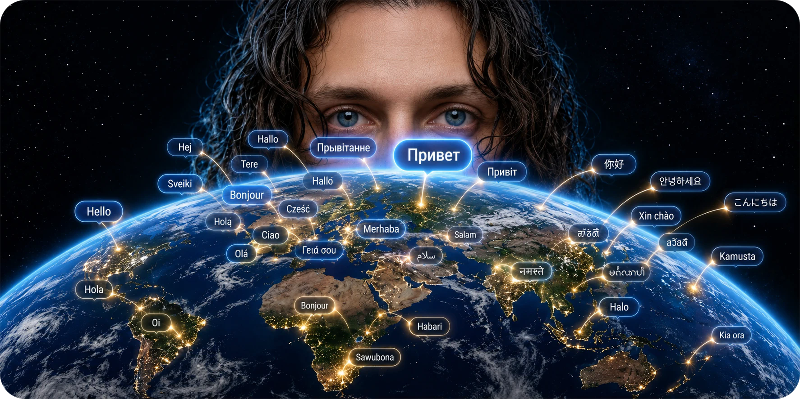
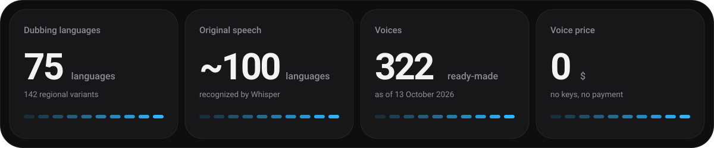
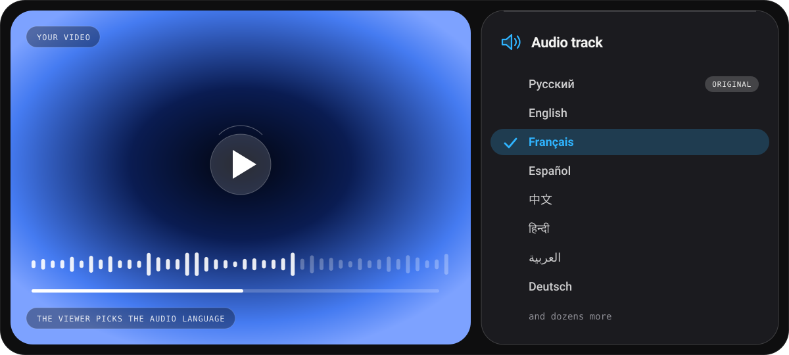
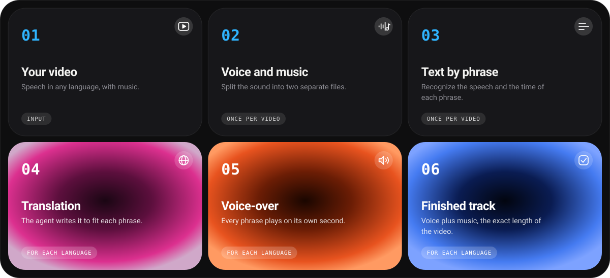
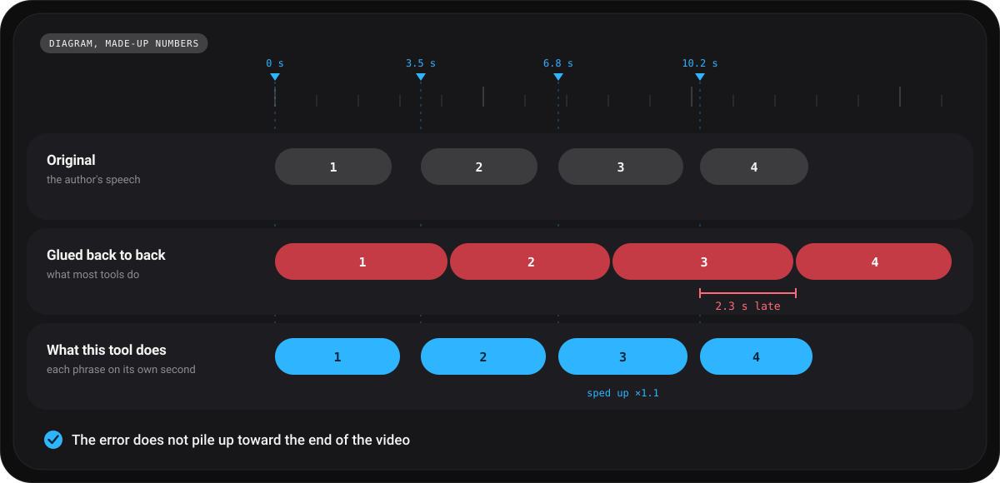
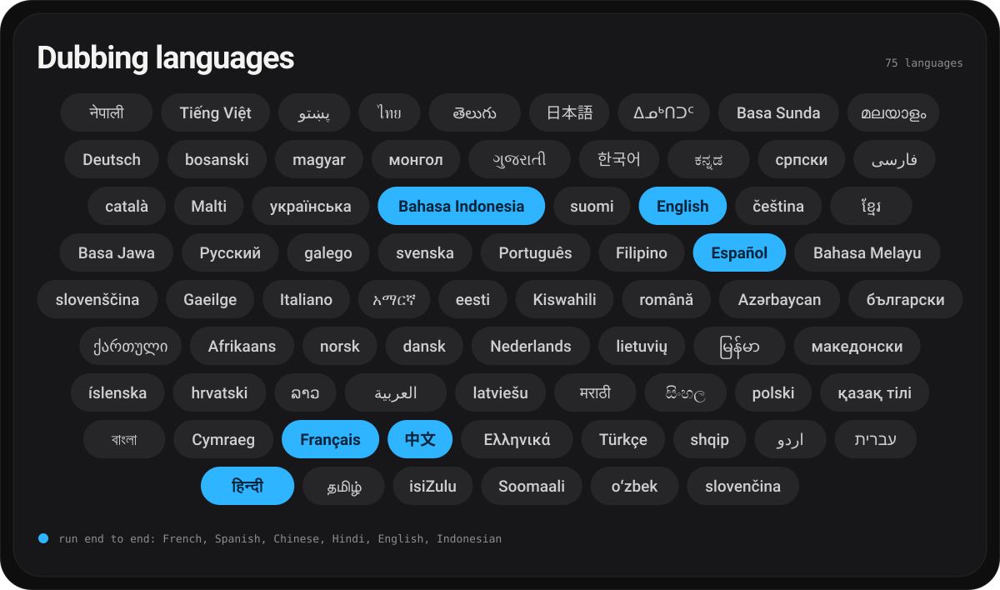
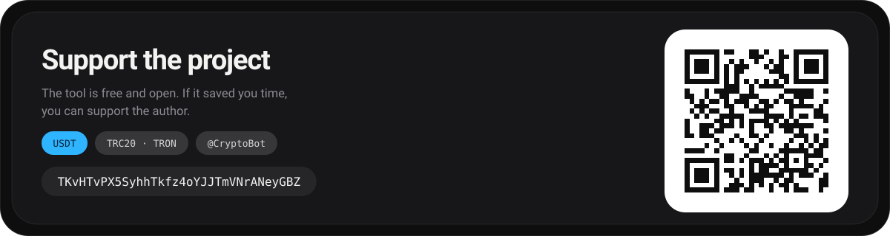

# YouTube Audio Translation

[Русская версия](README.ru.md) · **YouTube: [subscribe to @oknehcvark](https://www.youtube.com/@oknehcvark)**



**Dub your video into 75 languages. The voice speaks another language, your music stays, and the viewer picks
the audio language right in the YouTube player.**



## What it is, in plain words

You made a video in Russian. This tool turns it into versions in French, Spanish, Hindi, Chinese and other
languages. It is **not subtitles but a real voice-over**: another voice speaks, the music is yours, and the
pace stays like the original. The result is an audio track that you add to the video on YouTube next to the
original one.



*How it looks for the viewer (an illustration, not a screenshot).*

An AI agent ([Claude Code](https://claude.com/claude-code) or Codex) does all the work: you put the video in
a folder and say in one sentence which languages you want. The agent separates the voice from the music,
transcribes the speech, translates it, speaks it and builds the file. You only **listen to the result and
upload it to YouTube**.

## How it works



Steps 2 and 3 are done once per video, steps 4-6 are repeated for every language. The steps are described in
detail in [SKILL.md](skills/youtube-audio-translation/SKILL.md), the instructions the agent follows.

## The main idea: every phrase lands on the same second as in the original



*A diagram with made-up numbers.*

A translated phrase is often longer than the original one. If you speak the phrases and just glue them one
after another, the sound falls further behind with every phrase, and by the end of the video the voice is
talking about something else. This tool does not do that:

- **Phrases stand on the original seconds.** Each spoken phrase is placed at the start time of the original
  phrase.
- **The translation is written to fit the phrase.** The `budget` command tells how many characters fit into
  each phrase, and the agent translates to that size. This is the main reason the result stays in sync: an
  automatic translator knows nothing about how long a phrase may be.
- **Fit before the next phrase.** If a spoken phrase is still longer than the time it has, it is sped up (at
  most 1.5x, with pitch kept). If it is clearly shorter, the voice is slowed a little instead (down to -20%),
  so the pace stays close to the original speaker.
- **The length comes from the video.** YouTube rejects a track whose length differs from the video. A raw
  `.aac` has no length in its header, and `ffprobe` can be off by 15 seconds, so the tool takes the video
  file as the reference.
- **Loudness** of the dub is matched to the original voice, the music is kept at its original level.

## Which languages are supported



**You can dub into 75 languages**: 142 regional variants and 322 ready-made voices (the numbers as of 13
October 2026). The **original speech** can be in any of roughly 100 languages that the Whisper speech
recognizer understands.

That is not "every language in the world": you can dub into the languages that the free `edge-tts` voice
service has a voice for. If your language is not in the list, you cannot dub into it. For 12 languages
(English, French, Spanish, Portuguese, Italian, German, Russian, Hindi, Indonesian, Chinese, Japanese, Korean)
the phrase length was tuned on real runs. The rest use a fallback value and their quality was not checked: six
languages were run end to end (see [Tested](#tested)).

<details>
<summary><b>Show all 75 languages</b></summary>

🇿🇦 Afrikaans · 🇦🇱 Albanian · 🇪🇹 Amharic · 🇸🇦 Arabic · 🇦🇿 Azerbaijani · 🇧🇩 Bengali · 🇧🇦 Bosnian · 🇧🇬 Bulgarian · 🇲🇲 Burmese · 🇪🇸 Catalan · 🇨🇳 Chinese · 🇭🇷 Croatian · 🇨🇿 Czech · 🇩🇰 Danish · 🇳🇱 Dutch · 🇺🇸 English · 🇪🇪 Estonian · 🇵🇭 Filipino · 🇫🇮 Finnish · 🇫🇷 French · 🇪🇸 Galician · 🇬🇪 Georgian · 🇩🇪 German · 🇬🇷 Greek · 🇮🇳 Gujarati · 🇮🇱 Hebrew · 🇮🇳 Hindi · 🇭🇺 Hungarian · 🇮🇸 Icelandic · 🇮🇩 Indonesian · 🇨🇦 Inuktitut · 🇮🇪 Irish · 🇮🇹 Italian · 🇯🇵 Japanese · 🇮🇩 Javanese · 🇮🇳 Kannada · 🇰🇿 Kazakh · 🇰🇭 Khmer · 🇰🇷 Korean · 🇱🇦 Lao · 🇱🇻 Latvian · 🇱🇹 Lithuanian · 🇲🇰 Macedonian · 🇲🇾 Malay · 🇮🇳 Malayalam · 🇲🇹 Maltese · 🇮🇳 Marathi · 🇲🇳 Mongolian · 🇳🇵 Nepali · 🇳🇴 Norwegian (Bokmål) · 🇦🇫 Pashto · 🇮🇷 Persian · 🇵🇱 Polish · 🇧🇷 Portuguese · 🇷🇴 Romanian · 🇷🇺 Russian · 🇷🇸 Serbian · 🇱🇰 Sinhala · 🇸🇰 Slovak · 🇸🇮 Slovenian · 🇸🇴 Somali · 🇪🇸 Spanish · 🇮🇩 Sundanese · 🇰🇪 Swahili · 🇸🇪 Swedish · 🇮🇳 Tamil · 🇮🇳 Telugu · 🇹🇭 Thai · 🇹🇷 Turkish · 🇺🇦 Ukrainian · 🇵🇰 Urdu · 🇺🇿 Uzbek · 🇻🇳 Vietnamese · 🇬🇧 Welsh · 🇿🇦 Zulu

A table with example voices, the number of variants and language codes: [docs/languages.md](docs/languages.md).

</details>

## Use it with an agent

**What you need:** a computer with internet (tested on macOS), Python 3.10 or newer, a few GB of free disk
space (the first run downloads models: about 1.5 GB for speech recognition and about 70 MB for separating
voice from music), and **ffmpeg**. The agent installs what is missing, but it asks first.

1. Install [Claude Code](https://claude.com/claude-code) or Codex, and clone this repo:

   ```bash
   git clone https://github.com/oknehcvark/youtube-audio-translation
   cd youtube-audio-translation
   ```

2. Put your video in the folder, start the agent there, and say:

   > Read `skills/youtube-audio-translation/SKILL.md` and dub `my-video.mp4` into French and Spanish.

   The agent installs what is missing (it asks first), runs the pipeline, translates the text itself and
   brings you `final.m4a` and a `.srt` for every language. (For Claude Code you can also copy
   `skills/youtube-audio-translation` into `~/.claude/skills/` and just ask for the dubbing.)

3. **Listen to the result**, ideally with a native speaker. The agent can measure the length and timing,
   but it cannot hear the audio.

4. Upload to YouTube: YouTube Studio -> Subtitles -> add the language -> add the audio track (and the
   `.srt` as that language's subtitles).

## Without an agent

For those who like the command line. In this case you write the translation yourself.

<details>
<summary><b>Show the commands</b></summary>

```bash
pip install -r requirements.txt            # numpy, soundfile, edge-tts, faster-whisper, pyrubberband
pip install "audio-separator[cpu]"         # only for splitting voice and music
D=skills/youtube-audio-translation/scripts/dub.py

python3 $D separate video.mp4 -o work                               # work/vocals.wav + work/music.wav
python3 $D transcribe work/vocals.wav --lang ru -o work/source.srt  # fix the mistakes by hand
python3 $D budget work/source.srt --lang fr                         # how many characters fit each phrase
#   write work/lines.fr.json: a JSON list with one translated string per phrase
python3 $D srt work/source.srt work/lines.fr.json -o work/fr.srt
python3 $D build work/fr.srt --ref video.mp4 --voice fr-FR-HenriNeural -o work/fr --loudness-ref work/vocals.wav
python3 $D mix work/fr/dub_only.wav --music work/music.wav --ref video.mp4 -o work/fr/final
python3 $D check work/fr/dub_only.wav work/fr.srt --lang fr --ref video.mp4
```

You also need the **ffmpeg** binary (4.4 or newer): `brew install ffmpeg`, `winget install ffmpeg`,
`apt install ffmpeg`. `rubberband` (`brew install rubberband`) is optional and gives nicer speed-ups.
Voices: `edge-tts --list-voices`.

</details>

## Tested

**First test.** An 8 min 43 s review video (Russian speech with music), dubbed into four languages. Every
phrase starts on the original second, none spills into the next one, and each track has the exact length of
the video. The French track was accepted by YouTube. The speech recognizer "listened" to each dub again, and
we compared what share of the words did not match our text:

| Language | Voice | Speed-up needed (max) | Re-read error |
|---|---|---|---|
| French | fr-FR-Henri | 1.05x | 3.5% WER |
| Spanish | es-MX-Jorge | 1.17x | 5.0% WER |
| Chinese | zh-CN-Yunxi | 1.14x | 14.1% CER (digits and Latin names) |
| Hindi | hi-IN-Madhur | 1.25x | 20.6% WER (spelling variants) |

**Second test.** A 13 min 40 s conversational review (two people talking fast, some English phrases, music
and engine noise in the background), dubbed into six languages with the same checks. It added English
(Australia) and Indonesian:

| Language | Voice | Speed-up needed (max) | Re-read error |
|---|---|---|---|
| French | fr-FR-Henri | 1.22x | 4.8% WER |
| Spanish | es-MX-Jorge | 1.25x | 4.4% WER |
| English (Australia) | en-AU-William | 1.18x | 2.5% WER |
| Indonesian | id-ID-Ardi | 1.24x | 5.3% WER |
| Chinese | zh-CN-Yunxi | 1.21x | 5.5% CER |
| Hindi | hi-IN-Madhur | 1.25x | 21.9% WER (see below) |

The Hindi figure looks bad but is largely the measurement: `check --verbose` lists the phrases that were read
differently, and the worst ones are numbers (the recognizer spells "103.4" out in words), foreign words that
it writes in Latin letters (Smart, Basic, USB) while the track says them in Devanagari, and one-word replies
where a single wrong letter is 100%. That is not proof that the voice is fine: nobody listened to it.

WER is the share of wrong words, CER the share of wrong characters (used for Chinese). The author did not
listen to the Spanish, Hindi, Chinese, Indonesian and English tracks with a native speaker. Treat the numbers
as "the words are there and on time", not as a review of the translation or the sound.

## Limits

- The voices are stock voices, not your own voice, and there is one voice per track. Two speakers in the
  video are both voiced by the same voice.
- `edge-tts` uses Microsoft Edge's online voices without an official key: free, but unofficial, and it can
  change or stop working. It needs the internet.
- The translation is written by the AI agent. It is stronger in big languages and weaker in rare ones: the
  rarer the language, the more it matters to have a native speaker listen before you publish. More in
  [docs/languages.md](docs/languages.md).
- Tested on macOS (Apple Silicon). The code is cross-platform and the tests run on Linux, macOS and Windows,
  but the whole pipeline was not run on Windows or Linux.
- If `import scipy` crashes on macOS (a `dlopen` error) while installing `audio-separator`, use
  `pip install scipy==1.14.1`.
- Dub only videos you own or have the right to translate.

## FAQ

**Is it free?** The tool and the voices are free. You may have to pay for the AI agent (Claude Code or Codex)
under its own plan.

**Do I need to know how to code?** Hardly. You need to install the agent, open a terminal in the folder with
the video and write a request in plain words. The agent does the rest and asks before installing anything.

**Will it be my voice?** No. The voice is a stock one, one per track. You can pick a male or a female voice
among those available for the language.

**Can I do several languages at once?** Yes, list them in the request: "into French, Spanish and Hindi".

**How long does it take?** It depends on the length of the video and the power of the computer. There are no
timing measurements in the repository yet.

**What if something does not work?** Look at the "If something goes wrong" section of
[SKILL.md](skills/youtube-audio-translation/SKILL.md), then
[open an issue](https://github.com/oknehcvark/youtube-audio-translation/issues) and attach the output of the
command.

## Support the project



The tool is free and open. If it saved you time, you can support the author: **USDT on the TRC20 (TRON)
network**, a wallet in the Telegram bot [@CryptoBot](https://t.me/CryptoBot). Copy the address or scan the QR
code above:

```text
TKvHTvPX5SyhhTkfz4oYJJTmVNrANeyGBZ
```

Send only USDT on the TRC20 network. If you send another coin or use another network, the money can be lost.

## Tests

```bash
pip install numpy soundfile pytest
pytest -q
```

They cover the timing logic (placement, speed-up, slow-down, phrase grouping, subtitles, error rate) and
need no network, models or media.

## Author

Roman - [@oknehcvark on YouTube](https://www.youtube.com/@oknehcvark). Subscribe if this was useful.

## License

MIT
