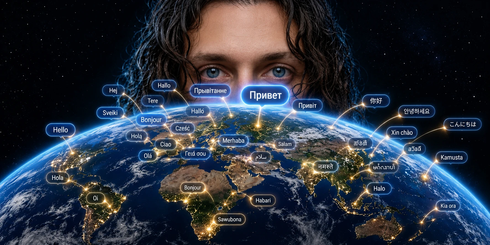
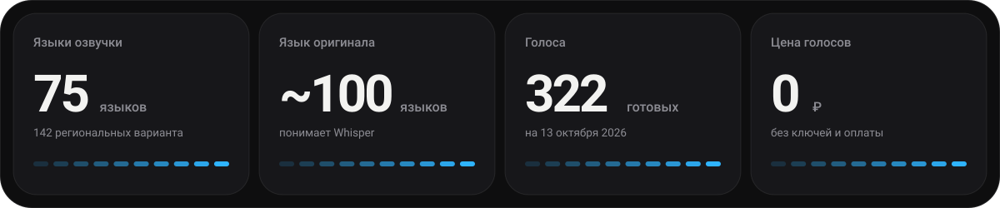
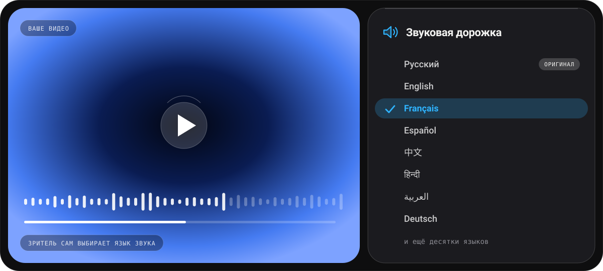
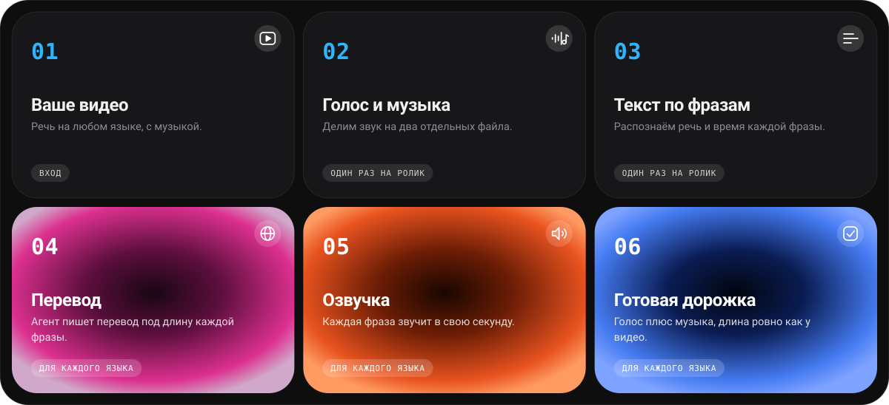
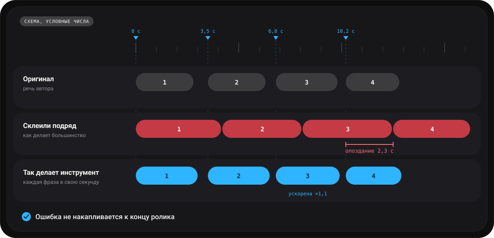
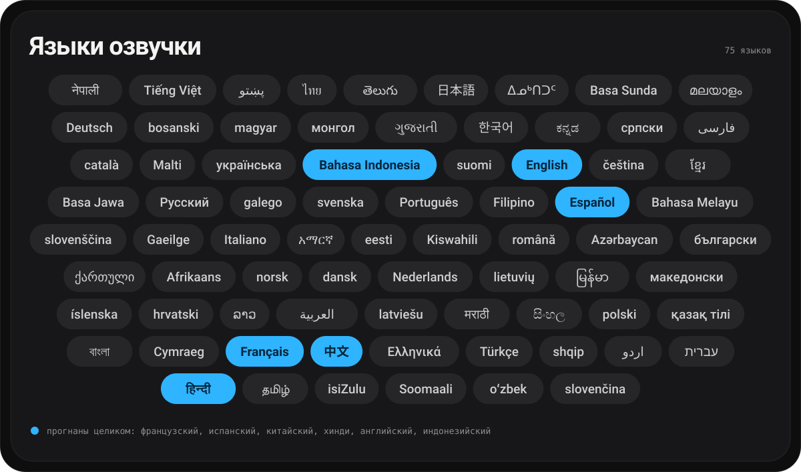

# YouTube Audio Translation



**Озвучьте своё видео на 75 языках. Голос говорит на другом языке, ваша музыка остаётся, а зритель выбирает
язык звука прямо в плеере YouTube.**



[English version](README.md) · **YouTube: [подписывайтесь на @oknehcvark](https://www.youtube.com/@oknehcvark)**

## Что это, простыми словами

Вы сняли ролик на русском. Инструмент делает из него версии на французском, испанском, хинди, китайском и
других языках. Это **не субтитры, а настоящая озвучка**: звучит другой голос, но музыка ваша, а темп
остаётся как в оригинале. Результат: звуковая дорожка, которую вы добавляете к видео на YouTube рядом с
оригинальной.



*Так это выглядит для зрителя (иллюстрация, не снимок экрана).*

Всю работу делает ИИ-агент ([Claude Code](https://claude.com/claude-code) или Codex): вы кладёте видео в
папку и пишете одной фразой, на какие языки его озвучить. Агент сам отделяет голос от музыки, распознаёт
речь, переводит, озвучивает и собирает файл. Вам остаётся **послушать результат и загрузить его на YouTube**.

## Как это работает



Шаги 2 и 3 делаются один раз на ролик, шаги 4-6 повторяются для каждого языка. Подробности шагов описаны в
[SKILL.md](skills/youtube-audio-translation/SKILL.md): это инструкция, по которой работает агент.

## Главная идея: каждая фраза звучит в ту же секунду, что и в оригинале



*Схема с условными числами.*

Переведённая фраза часто получается длиннее оригинальной. Если озвучить фразы и просто склеить их одну за
другой, звук с каждой фразой отстаёт всё сильнее, и к концу ролика голос говорит уже о другом. Здесь так не
происходит:

- **Фразы стоят на секундах оригинала.** Каждая озвученная фраза ставится на время начала оригинальной.
- **Перевод пишется под длину фразы.** Команда `budget` говорит, сколько знаков влезает в каждую фразу, и
  агент переводит в этот размер. Это главная причина, почему результат не уезжает по времени: обычный
  автопереводчик о длине фразы ничего не знает.
- **Влезть до следующей фразы.** Если озвученная фраза всё же длиннее своего отрезка, её ускоряют (не более
  чем в 1,5 раза, высота голоса сохраняется). Если заметно короче, голос слегка замедляют (до -20%), чтобы
  темп был близок к оригинальному диктору.
- **Длина берётся у видео.** YouTube отвергает дорожку, длина которой не совпадает с видео. У сырого `.aac`
  в заголовке нет длины, и `ffprobe` может ошибиться на 15 секунд, поэтому инструмент ориентируется на
  видеофайл.
- **Громкость** дубляжа подгоняется под оригинальный голос, музыка остаётся на исходном уровне.

## Какие языки поддерживаются



**Озвучить можно на 75 языков**: это 142 региональных варианта и 322 готовых голоса (данные на 13 октября
2026 года). **Язык оригинала** может быть любым из примерно 100, которые понимает распознаватель речи
Whisper.

Это не «все языки мира»: озвучить можно на те языки, для которых у бесплатного сервиса голосов `edge-tts`
есть голос. Если вашего языка нет в списке, озвучить на него нельзя. Для 11 языков (английский,
французский, испанский, португальский, итальянский, немецкий, русский, хинди, китайский, японский,
корейский) длина фраз подобрана на реальных запусках. Остальные работают на запасном значении, и качество
там не проверялось: полностью прогнаны четыре языка (см. [«Проверено»](#проверено)).

<details>
<summary><b>Показать все 75 языков</b></summary>

🇦🇿 Азербайджанский · 🇦🇱 Албанский · 🇪🇹 Амхарский · 🇺🇸 Английский · 🇸🇦 Арабский · 🇿🇦 Африкаанс · 🇧🇩 Бенгальский · 🇲🇲 Бирманский · 🇧🇬 Болгарский · 🇧🇦 Боснийский · 🇬🇧 Валлийский · 🇭🇺 Венгерский · 🇻🇳 Вьетнамский · 🇪🇸 Галисийский · 🇬🇷 Греческий · 🇬🇪 Грузинский · 🇮🇳 Гуджарати · 🇩🇰 Датский · 🇿🇦 Зулу · 🇮🇱 Иврит · 🇮🇩 Индонезийский · 🇨🇦 Инуктитут · 🇮🇪 Ирландский · 🇮🇸 Исландский · 🇪🇸 Испанский · 🇮🇹 Итальянский · 🇰🇿 Казахский · 🇮🇳 Каннада · 🇪🇸 Каталанский · 🇨🇳 Китайский · 🇰🇷 Корейский · 🇰🇭 Кхмерский · 🇱🇦 Лаосский · 🇱🇻 Латышский · 🇱🇹 Литовский · 🇲🇰 Македонский · 🇲🇾 Малайский · 🇮🇳 Малаялам · 🇲🇹 Мальтийский · 🇮🇳 Маратхи · 🇲🇳 Монгольский · 🇩🇪 Немецкий · 🇳🇵 Непальский · 🇳🇱 Нидерландский · 🇳🇴 Норвежский (букмол) · 🇮🇷 Персидский (фарси) · 🇵🇱 Польский · 🇧🇷 Португальский · 🇦🇫 Пушту · 🇷🇴 Румынский · 🇷🇺 Русский · 🇷🇸 Сербский · 🇱🇰 Сингальский · 🇸🇰 Словацкий · 🇸🇮 Словенский · 🇸🇴 Сомалийский · 🇰🇪 Суахили · 🇮🇩 Сундский · 🇹🇭 Тайский · 🇮🇳 Тамильский · 🇮🇳 Телугу · 🇹🇷 Турецкий · 🇺🇿 Узбекский · 🇺🇦 Украинский · 🇵🇰 Урду · 🇵🇭 Филиппинский (тагальский) · 🇫🇮 Финский · 🇫🇷 Французский · 🇮🇳 Хинди · 🇭🇷 Хорватский · 🇨🇿 Чешский · 🇸🇪 Шведский · 🇪🇪 Эстонский · 🇮🇩 Яванский · 🇯🇵 Японский

Таблица с примерами голосов, числом вариантов и кодами языков: [docs/languages.ru.md](docs/languages.ru.md).

</details>

## Как пользоваться с агентом

**Что понадобится:** компьютер с интернетом (проверено на macOS), Python 3.10 или новее, несколько гигабайт свободного места (при
первом запуске скачиваются модели: около 1,5 ГБ для распознавания речи и около 70 МБ для отделения голоса от
музыки), программа **ffmpeg**. Недостающее агент доустановит сам, но сначала спросит разрешение.

1. Установите [Claude Code](https://claude.com/claude-code) или Codex и склонируйте репозиторий:

   ```bash
   git clone https://github.com/oknehcvark/youtube-audio-translation
   cd youtube-audio-translation
   ```

2. Положите видео в папку, запустите агента в ней и напишите:

   > Прочитай `skills/youtube-audio-translation/SKILL.md` и сделай дубляж `my-video.mp4` на французский и испанский.

   Агент спросит разрешение и доустановит недостающее, запустит весь процесс, сам переведёт текст и
   принесёт `final.m4a` и `.srt` для каждого языка. (В Claude Code можно скопировать папку
   `skills/youtube-audio-translation` в `~/.claude/skills/` и просто просить дубляж.)

3. **Послушайте результат**, лучше вместе с носителем языка. Агент может измерить длину и тайминг, но не
   слышит звук.

4. Загрузите на YouTube: YouTube Studio -> Субтитры -> добавить язык -> добавить аудиодорожку (а `.srt`
   загрузите как субтитры этого языка).

## Без агента

Для тех, кто привык к командной строке. Перевод в этом случае пишете вы сами.

<details>
<summary><b>Показать команды</b></summary>

```bash
pip install -r requirements.txt            # numpy, soundfile, edge-tts, faster-whisper, pyrubberband
pip install "audio-separator[cpu]"         # только чтобы отделять голос от музыки
D=skills/youtube-audio-translation/scripts/dub.py

python3 $D separate video.mp4 -o work                               # work/vocals.wav + work/music.wav
python3 $D transcribe work/vocals.wav --lang ru -o work/source.srt  # ошибки поправьте вручную
python3 $D budget work/source.srt --lang fr                         # сколько знаков влезает в каждую фразу
#   напишите work/lines.fr.json: JSON-список, по одной переведённой строке на фразу
python3 $D srt work/source.srt work/lines.fr.json -o work/fr.srt
python3 $D build work/fr.srt --ref video.mp4 --voice fr-FR-HenriNeural -o work/fr --loudness-ref work/vocals.wav
python3 $D mix work/fr/dub_only.wav --music work/music.wav --ref video.mp4 -o work/fr/final
python3 $D check work/fr/dub_only.wav work/fr.srt --lang fr --ref video.mp4
```

Ещё нужен **ffmpeg** (версии 4.4 и новее): `brew install ffmpeg`, `winget install ffmpeg`,
`apt install ffmpeg`. `rubberband` (`brew install rubberband`) необязателен, но ускорение с ним звучит лучше.
Голоса: `edge-tts --list-voices`.

</details>

## Проверено

На обзорном ролике 8 мин 43 с (русская речь с музыкой), дубляж на четыре языка. Каждая фраза начинается
на секунде оригинала, ни одна не заходит на следующую, у каждой дорожки длина ровно как у видео.
Французскую дорожку YouTube принял. Распознаватель речи заново «прослушал» каждый дубляж, и мы сравнили,
какая доля слов не совпала с нашим текстом:

| Язык | Голос | Нужное ускорение (макс.) | Ошибка перечитывания |
|---|---|---|---|
| Французский | fr-FR-Henri | 1,05x | 3,5% WER |
| Испанский | es-MX-Jorge | 1,17x | 5,0% WER |
| Китайский | zh-CN-Yunxi | 1,14x | 14,1% CER (цифры и латинские названия) |
| Хинди | hi-IN-Madhur | 1,25x | 20,6% WER (варианты написания) |

WER это доля неверных слов, CER доля неверных знаков (для китайского). Испанскую, хинди и китайскую дорожки
автор не слушал с носителем языка. Эти цифры означают «слова на месте и вовремя», а не оценку качества
перевода и звучания.

## Ограничения

- Голоса стандартные, не ваш собственный, и один голос на дорожку. Если в видео говорят двое, озвучит
  обоих один голос.
- `edge-tts` использует онлайн-голоса Microsoft Edge без официального ключа: бесплатно, но неофициально, и
  может измениться или перестать работать. Нужен интернет.
- Перевод пишет ИИ-агент. На больших языках он сильнее, на редких слабее: чем реже язык, тем важнее дать
  послушать дорожку носителю до публикации. Подробнее: [docs/languages.ru.md](docs/languages.ru.md).
- Проверено на macOS (Apple Silicon). Код кроссплатформенный, тесты идут на Linux, macOS и Windows, но весь
  процесс целиком на Windows и Linux не запускался.
- Если при установке `audio-separator` на macOS падает `import scipy` (ошибка `dlopen`), поставьте
  `pip install scipy==1.14.1`.
- Дублируйте только видео, которыми владеете или которые вправе переводить.

## Частые вопросы

**Это бесплатно?** Сам инструмент и голоса бесплатны. За работу ИИ-агента (Claude Code или Codex) может
понадобиться платить по его тарифу.

**Нужно ли уметь программировать?** Почти нет. Нужно установить агента, открыть терминал в папке с видео и
написать запрос обычными словами. Остальное агент делает сам и спрашивает разрешение, когда что-то нужно
установить.

**Это будет мой голос?** Нет. Голос стандартный, один на дорожку. Можно выбрать мужской или женский из
доступных для языка.

**Можно сразу на несколько языков?** Да, перечислите их в запросе: «на французский, испанский и хинди».

**Сколько это займёт?** Зависит от длины ролика и мощности компьютера. Замеров времени в репозитории пока нет.

**Что делать, если что-то не работает?** Посмотрите раздел «Если что-то пошло не так» в
[SKILL.md](skills/youtube-audio-translation/SKILL.md), а затем
[откройте issue](https://github.com/oknehcvark/youtube-audio-translation/issues) и приложите вывод команды.

## Тесты

```bash
pip install numpy soundfile pytest
pytest -q
```

Они покрывают логику тайминга (расстановка, ускорение, замедление, разбиение на фразы, субтитры, ошибка
распознавания) и не требуют сети, моделей и медиафайлов.

## Автор

Роман - [@oknehcvark на YouTube](https://www.youtube.com/@oknehcvark). Подписывайтесь, если было полезно.

## Лицензия

MIT
